<a href="https://launchnest.com.au">
<picture>
  <source media="(prefers-color-scheme: dark)" srcset="./assets/hero-dark.svg" />
  <source media="(prefers-color-scheme: light)" srcset="./assets/hero-light.svg" />
  
</picture>
</a>

I run [Launch Nest Studio](https://launchnest.com.au), an Adelaide studio building websites, brands and search visibility for Australian businesses. I'm also building [FormaOS](https://formaos.com.au), a multi-tenant compliance platform for NDIS, aged care, healthcare, financial services, education and construction.

I design the system, build it, test it hard and ship it to production.

### Search visibility

<picture>
  <source media="(prefers-color-scheme: dark)" srcset="./assets/search-dark.svg" />
  <source media="(prefers-color-scheme: light)" srcset="./assets/search-light.svg" />
  
</picture>

### FormaOS architecture

<picture>
  <source media="(prefers-color-scheme: dark)" srcset="./assets/architecture-dark.svg" />
  <source media="(prefers-color-scheme: light)" srcset="./assets/architecture-light.svg" />
  
</picture>

### How I ship

<picture>
  <source media="(prefers-color-scheme: dark)" srcset="./assets/ship-dark.svg" />
  <source media="(prefers-color-scheme: light)" srcset="./assets/ship-light.svg" />
  
</picture>

### Stack

<picture>
  <source media="(prefers-color-scheme: dark)" srcset="./assets/stack-dark.svg" />
  <source media="(prefers-color-scheme: light)" srcset="./assets/stack-light.svg" />
  
</picture>

 

<a href="https://launchnest.com.au">
<picture>
  <source media="(prefers-color-scheme: dark)" srcset="./assets/contact-dark.svg" />
  <source media="(prefers-color-scheme: light)" srcset="./assets/contact-light.svg" />
  
</picture>
</a>
