<picture>
  <source media="(prefers-color-scheme: dark)" srcset="./assets/hero-dark.svg" />
  <source media="(prefers-color-scheme: light)" srcset="./assets/hero-light.svg" />
  
</picture>

## Selected work

<a href="https://formaos.com.au">
<picture>
  <source media="(prefers-color-scheme: dark)" srcset="./assets/work-formaos-dark.svg" />
  <source media="(prefers-color-scheme: light)" srcset="./assets/work-formaos-light.svg" />
  
</picture>
</a>

 

<a href="https://launchnest.com.au">
<picture>
  <source media="(prefers-color-scheme: dark)" srcset="./assets/work-launchnest-dark.svg" />
  <source media="(prefers-color-scheme: light)" srcset="./assets/work-launchnest-light.svg" />
  
</picture>
</a>

## Architecture

How FormaOS keeps every organisation's data separate: a request is authorised, reads its own tenant, and gets nothing back when it reaches for another.

<picture>
  <source media="(prefers-color-scheme: dark)" srcset="./assets/architecture-dark.svg" />
  <source media="(prefers-color-scheme: light)" srcset="./assets/architecture-light.svg" />
  
</picture>

## Engineering process

Every check shown here runs in the FormaOS GitHub Actions pipeline.

<picture>
  <source media="(prefers-color-scheme: dark)" srcset="./assets/process-dark.svg" />
  <source media="(prefers-color-scheme: light)" srcset="./assets/process-light.svg" />
  
</picture>

## Stack

<picture>
  <source media="(prefers-color-scheme: dark)" srcset="./assets/stack-dark.svg" />
  <source media="(prefers-color-scheme: light)" srcset="./assets/stack-light.svg" />
  
</picture>

 

<a href="https://launchnest.com.au">
<picture>
  <source media="(prefers-color-scheme: dark)" srcset="./assets/contact-dark.svg" />
  <source media="(prefers-color-scheme: light)" srcset="./assets/contact-light.svg" />
  
</picture>
</a>
